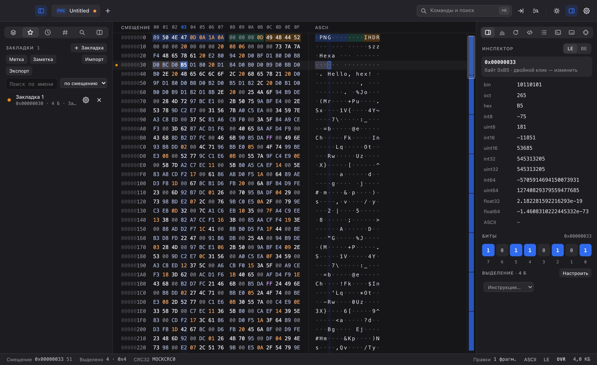
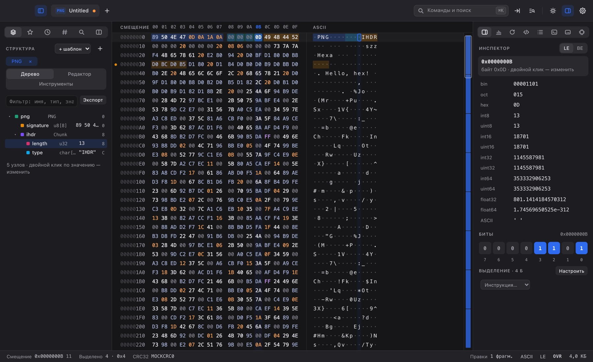
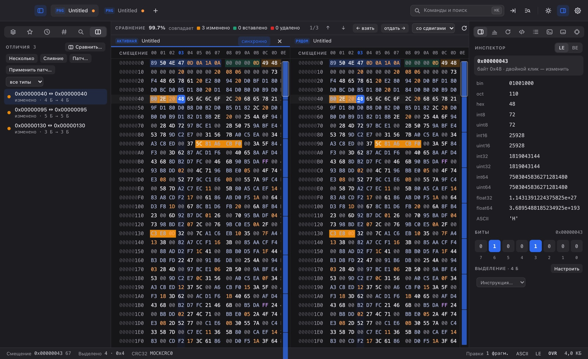
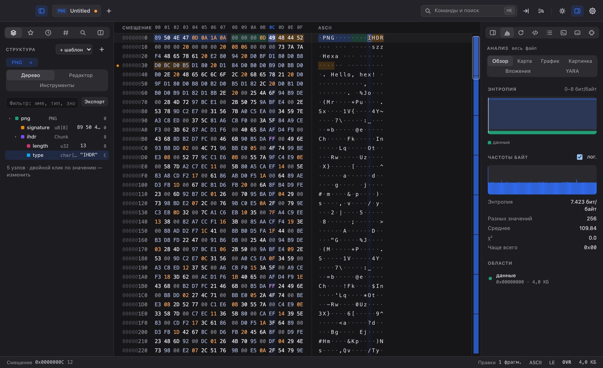
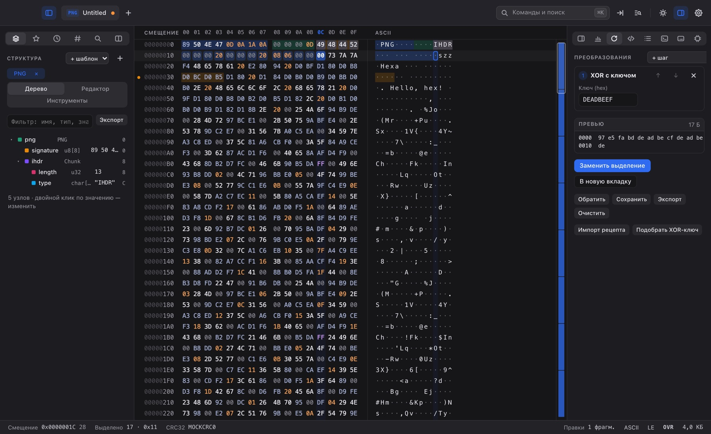
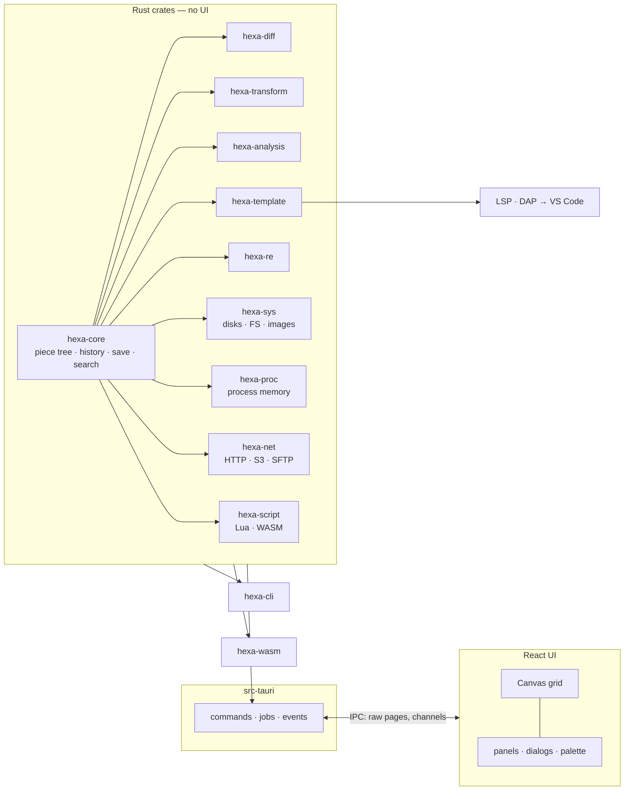

<p align="center">
  
</p>

<h1 align="center">Hexa</h1>

<p align="center">
  <b>A hex editor for files of any size — and for disks, process memory and the network.</b><br>
  Opens 100 GB as fast as 100 bytes. Edits never touch the original until you save.
</p>

<p align="center">
  <a href="#-build-from-source"><b>🛠️ Build from source</b></a>
  &nbsp;·&nbsp;
  <a href="#-command-line">Command line</a>
  &nbsp;·&nbsp;
  <a href="#%EF%B8%8F-architecture">Architecture</a>
</p>

<p align="center">
  
  
  
  
  
  <br>
  
  
  
  
  
  <a href="LICENSE"></a>
</p>

<p align="center">
  
</p>

## ✨ Highlights

- ⚡️ **Instant on any size.** Only the visible pages are read; edits live in a persistent piece tree, so copying a gigabyte is a reference and a 100 GB file scrolls at 60 fps.
- 🌳 **History is a tree.** Undo, redo, branches and reverting a single edit from the middle. Undo still works after saving, thanks to a write journal.
- 💾 **Saves you can trust.** Atomic save with permissions and xattrs kept, or in-place writes ordered by a dependency graph that need no free disk space and roll back after a crash.
- 🧩 **Structures.** An ImHex-style template language plus Kaitai, 010 Editor, C header, DWARF and PDB importers, 28 built-in formats, a live tree synced with the grid, in-place editing, an LSP and a debugger.
- 🔀 **Compare and patch.** Shift-aware diff, N-way and three-way merge, field-level diff over templates, and IPS / UPS / BPS / VCDIFF / bsdiff patches.
- 🔬 **Analysis.** Entropy and data-class maps, Hilbert curves, byte histograms, strings, embedded files, YARA rules, 100+ hashes including ssdeep and TLSH.
- 🛠️ **Reverse engineering.** PE / ELF / Mach-O, disassembly for every Capstone architecture, inline assembly patches with NOP padding, cross-references, patch lists that port to new versions.
- 🔁 **Transformations.** Recipes of XOR, shifts, Base64/85, zlib/zstd/LZMA, AES/ChaCha20 and more, with live preview, write-back and XOR key guessing.
- 💽 **Beyond files.** Raw disks, partitions and file systems (FAT, exFAT, ext, NTFS, ISO), disk images (VHD/VHDX/VMDK/QCOW2/DMG/E01), process memory with a scanner and pointer search, HTTP / S3 / SFTP and archives.
- 🧪 **Scriptable.** A sandboxed Lua console, macros, WASM plugins, a local HTTP API, a headless CLI with CI exit codes, and the core as a WebAssembly npm package.
- 🎨 **Pleasant to use.** Split panes, folds, a fuzzy command palette that understands the wrong keyboard layout, Vim and Emacs keymaps, themes, spring animations, colour-blind-safe highlights and a screen reader mode.

> [!TIP]
> Press <kbd>⌘K</kbd> / <kbd>Ctrl K</kbd> for the command palette and <kbd>F1</kbd> for every command with its shortcut.

## 📸 Screenshots

| Structure templates | Side-by-side diff |
| :---: | :---: |
|  |  |
| **Analysis** | **Transformations** |
|  |  |

## 🛠️ Build from source

### Requirements

- [Rust](https://rustup.rs) 1.95 or later
- [bun](https://bun.sh)
- The [Tauri prerequisites](https://tauri.app/start/prerequisites/) for your OS (WebView2 on Windows, `webkit2gtk` on Linux)

### Run and build

```sh
git clone https://github.com/kewldan/hexa.git && cd hexa
bun install
bun run tauri dev        # the app
bun run tauri build      # .dmg/.app, .msi/.exe, .deb/.rpm/.AppImage
bun run dev              # the UI alone in a browser, on a mock backend
```

### Checks

The same as CI:

```sh
bunx biome ci . && bunx tsc --noEmit
cargo fmt --all --check && cargo clippy --workspace --all-targets -- -D warnings
cargo test --workspace                 # unit, integration and property tests of every crate
bunx vitest run                        # UI unit tests, including the translation check
bunx playwright test                   # UI scenarios against the mock backend
cd crates/hexa-core && cargo +nightly fuzz run document_ops
```

> [!NOTE]
> Raw disks need Hexa to run with administrator rights; processes need the usual debugger permission (`ptrace`, `task_for_pid` or `SeDebugPrivilege`). Hexa explains what to change when access is refused. Portable mode: put a `hexa-data` folder or an empty `portable` file next to the executable.

## 💻 Command line

`hexa-cli` runs the same engine headless. Every subcommand takes `--json`.

```sh
hexa-cli info firmware.bin                      # size, entropy, detected format
hexa-cli hash image.iso -a sha256,crc32 --expect sha256=…
hexa-cli search dump.bin --hex "DE AD ?? EF" --count
hexa-cli diff old.bin new.bin --stats -f json
hexa-cli patch create old.rom new.rom -o fix.bps
hexa-cli convert app.bin -o app.hex --base 0x08000000
hexa-cli template disk.img gpt                  # template → JSON
hexa-cli exe app.exe --disasm entry -n 20
```

Exit codes for CI: **0** success, **1** negative answer (files differ, nothing found, checksum mismatch), **2** usage error, **3** I/O error, **4** data or format error.

Also in the box: [`crates/hexa-wasm`](crates/hexa-wasm) — the core as an npm package for browsers and Node — and [`editors/vscode`](editors/vscode) — template language support for VS Code.

## 🏗️ Architecture



- **The document lives in Rust.** The UI asks for the visible window as a raw `ArrayBuffer` and keeps a small page cache. Edits are commands; long jobs stream progress over channels and can always be cancelled.
- **Persistent B+-tree of pieces** (`{source, offset, length}`) with path copying: every edit costs O(log n) memory, fills and random data are never materialised, merge results and applied patches reference their inputs.
- **Snapshots everywhere.** Search, hashes, diff and analysis run on a snapshot without locks while you keep editing; bookmarks move with the bytes they mark.
- **Sandboxed extensions.** Lua with memory, instruction and time limits; WASM plugins with fuel and memory caps; YARA in pure Rust; the local API listens on 127.0.0.1 only and needs a token.

<details>
<summary>🗂️ Project layout</summary>

```
crates/
  hexa-core        providers, piece tree, history, saving, search, encodings, inspector
  hexa-diff        diff, N-way, merge, patch formats
  hexa-transform   bit ops, arithmetic, codecs, compression, ciphers, recipes, graphs
  hexa-analysis    statistics, visualisation, strings, embedded files, firmware and dump formats
  hexa-template    template language, importers, format library, LSP and DAP servers
  hexa-re          executables, disassembly, assembly, patching, cross-references
  hexa-sys         disks, partitions, file systems, images, cloning, wiping, RAID, helper
  hexa-proc        process memory, scanner, pointer scan, GDB remote
  hexa-net         HTTP(S), S3, SFTP, network capture, archives
  hexa-script      Lua, macros, WASM plugins, catalog, local API
  hexa-cli         headless command line
  hexa-wasm        the core for browsers and Node
src-tauri/         Tauri commands, menu, windows, crash recovery
src/               React UI: grid, panels, dialogs, keymaps, i18n
e2e/               Playwright scenarios against the mock backend
editors/vscode/    VS Code extension for templates
```

</details>

## 🌍 Localization

Hexa speaks **Russian** and **English**. Russian is the source language; translations live in [`src/i18n/en.json`](src/i18n/en.json), and `bun scripts/i18n-extract.ts` lists anything missing — the test suite fails on an untranslated string. Switch the language in **Settings → Accessibility**.

## 🗺️ Known limitations

- 🔢 Offsets in the UI are JavaScript numbers: exact up to 2⁵³ bytes (8 PB).
- 🧮 The assembler covers x86/x64 fully and a subset of ARM64; AVR can't be disassembled (not in Capstone 5).
- 🧠 Live process memory is re-read on a timer; changed bytes aren't highlighted yet.
- 🔐 The privileged helper protocol exists, but the GUI doesn't launch it elevated yet — start Hexa as administrator for raw disks.
- 📦 The plugin and template catalog installs from a local file only.

## 📄 License

Hexa is released under the [MIT License](LICENSE).
